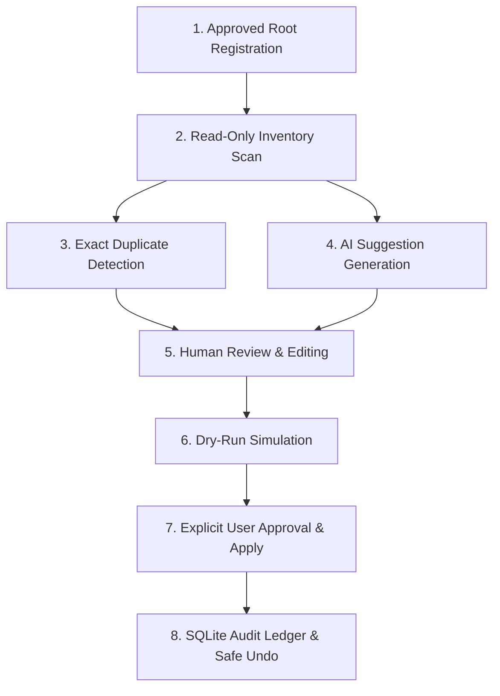
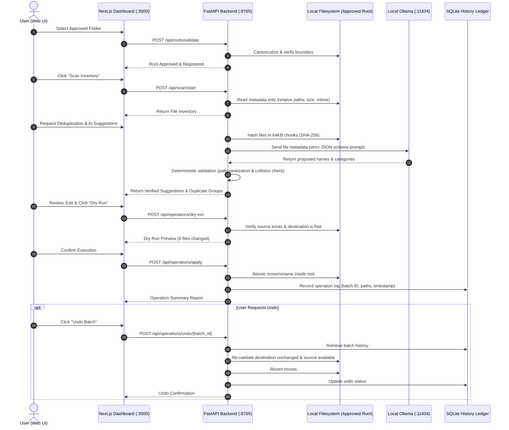

# TidyAI — Master Project Plan & Architecture Specification

**Project**: TidyAI — Privacy-First Local File Organization Assistant  
**Phase**: Phase 0 — Workspace Audit and Planning  
**Target Environment**: Windows (PowerShell) / Localhost  
**Status**: Ready for Review / Acceptance  

---

## 1. Executive Summary & Product Vision

**TidyAI** is an intelligent, local-first file organization assistant designed to help users declutter, categorize, deduplicate, and restructure disordered directories with absolute safety and transparency.

Unlike conventional file utilities or cloud-connected "smart" organizers, TidyAI operates under strict, non-negotiable safety guardrails:
- **Zero Cloud Leakage**: All inference runs locally via Ollama (`http://127.0.0.1:11434`). No file content or metadata is ever transmitted over external networks.
- **AI Proposes, Backend Disposes**: AI models are treated as untrusted suggestion generators. Every proposed path, category, and file name is verified by deterministic backend rules.
- **No Silent Overwrites, No Automatic Deletions**: Duplicate detection is purely diagnostic. Files are never deleted automatically.
- **Two-Stage Execution**: Every filesystem mutation requires human review, a dry-run preview, explicit secondary confirmation, and an audit trail backed by a safe, reversible undo mechanism.

---

## 2. Proposed Technology Stack

| Layer | Technology | Rationale & Configuration |
| :--- | :--- | :--- |
| **Frontend** | **Next.js (App Router) + TypeScript + Tailwind CSS** | Fast, responsive, calm UI; server/client boundary clarity; typed API contracts; accessible components. |
| **Backend** | **FastAPI + Pydantic v2 (Python 3.14)** | High-performance asynchronous API; strict schema validation; typed responses; native Windows path handling via `pathlib.Path.resolve()`. |
| **Local AI Provider** | **Ollama Local HTTP API** | Connects to `http://127.0.0.1:11434`; utilizes existing local model (`qwen3-vl:8b`); mockable client interface for automated testing. |
| **Persistence / Ledger** | **SQLite (via standard library `sqlite3`)** | Zero-dependency local relational store for audit history, operation logs, and reversible undo plans; stores paths and timestamps only, never file contents. |
| **Testing Framework** | **Pytest** | Comprehensive backend test coverage; isolated test fixtures using `tempfile.TemporaryDirectory()`; security edge-case regressions. |
| **Host / Network Binding** | **Localhost Only (`127.0.0.1`)** | Backend binds exclusively to `127.0.0.1:8765`; frontend binds to `127.0.0.1:3000`; no external network interfaces exposed. |

---

## 3. MVP Scope Definition

The Minimum Viable Product (MVP) covers end-to-end safe organization across 8 core functional pillars:

1. **Approved Root Registration**:
   - The user must explicitly register specific directories as allowed root boundaries.
   - Operations outside approved roots are rejected immediately by backend validation.
   - Filesystem roots (`C:\`, `D:\`), Windows system directories, and user home root roots are rejected as dangerous.

2. **Read-Only Inventory Scanner**:
   - Recursively enumerates files under approved roots without inspecting content.
   - Collects minimal metadata: relative path, filename, extension, file size, last modified timestamp, and broad MIME/file category.
   - Automatically ignores `.git`, `.venv`, `node_modules`, `__pycache__`, and system files.

3. **Exact Duplicate Detection (SHA-256)**:
   - Identifies identical files by chunked SHA-256 hashing (e.g., 64 KB blocks).
   - Groups duplicates cleanly in the UI for user awareness.
   - **Detection Only**: strictly no auto-delete or auto-move actions for duplicates.

4. **Local AI Suggestion Engine**:
   - Sends file metadata (name, extension, size, existing folder structure) to local Ollama.
   - Ollama proposes:
     - Standardized category (e.g., `Documents/Invoices`, `Media/Images`, `Code/Archives`).
     - Sanitized, consistent filename (e.g., `2024_03_Tax_Invoice.pdf`).
     - Proposed destination subfolder within the approved root.
     - Confidence score and rationale.
   - If Ollama is offline or times out, the application remains fully functional with manual categorization options.

5. **Human Review & Proposal Customization**:
   - The dashboard presents side-by-side comparison: `Original Path` vs. `Proposed Destination`.
   - The user can accept, edit, or reject individual suggestions or batches.

6. **Dry-Run Simulation**:
   - Generates an exact execution preview without making any filesystem modifications.
   - Validates existence of sources, absence of destination collisions, path boundary containment, and disk space.

7. **Safe Apply (Execution)**:
   - Requires explicit secondary user confirmation.
   - Re-validates every path immediately before moving or renaming.
   - Executes atomic moves/renames within the same volume.

8. **Audit History & Safe Undo**:
   - Records each operation batch in SQLite (batch ID, timestamp, source relative path, destination relative path, status).
   - "Safe Undo" verifies that the destination file still exists and has not been modified since the operation, and that the original location is free, before reverting. Refuses if conflicts exist.

---

## 4. Comprehensive Risk Analysis & Mitigation Matrix

| Risk Category | Threat / Failure Mode | Impact | Mitigation Strategy |
| :--- | :--- | :--- | :--- |
| **Path Traversal & Escapes** | Malicious or AI-generated `../`, `..\\`, absolute paths, drive letters (`C:\`), or UNC paths (`\\server\share`). | Files moved outside allowed root or system corruption. | Enforce strict containment using `pathlib.Path.resolve()`. Compute relative path to approved root; raise `SecurityError` if destination is outside root. |
| **Windows Junctions & Symlinks** | Symlinks or reparse points pointing outside the approved boundary. | Arbitrary file system access. | Inspect `is_symlink()` and Windows reparse points. Never follow links escaping the approved root boundary. |
| **Filename Collisions** | Destination file already exists or two items map to the same name. | Accidental data overwrite / data loss. | Re-check destination existence immediately before execution (`fail-closed`). Never overwrite. Reject or propose unique suffix (`_1`, `_2`). |
| **Reserved Windows Names** | Suggestions using `CON`, `PRN`, `AUX`, `NUL`, `COM1-COM9`, `LPT1-LPT9`, or trailing dots/spaces. | OS error, locked files, or filesystem corruption. | Deterministic backend regex sanitizes against Windows reserved keywords and invalid characters (`< > : " / \ | ? *`). |
| **Untrusted AI Output** | Model generates malformed JSON, markdown fences, invalid schemas, or prompt injection payloads. | Backend crash or unexpected path generation. | Strict Pydantic model validation (`model_validate_json`). Model output cannot bypass backend security checks. |
| **Interrupted Moves / Partial Batches** | Process killed mid-batch, power failure, or disk full error. | Half-completed batch, uncertain state. | Pre-flight disk checks; execute item-by-item; record status of each file in SQLite; provide clear recovery report. |
| **AI Daemon Outage** | Ollama is stopped, busy, or the model is missing. | Application failure or hang. | Bounded HTTP timeouts (e.g., 10s); graceful degradation banner; core scanner and duplicates features work without AI. |
| **Undo Conflicts** | User attempts to undo after destination file was edited, deleted, or source was re-occupied. | Corrupted file restoration or overwriting new content. | Pre-undo state check: verify file hash and size at destination match post-move state, and verify source location is empty. |
| **Privacy & Leakage** | Telemetry, external API calls, or logging sensitive document contents. | Breach of local privacy guarantees. | No third-party network calls; zero external analytics; backend logs paths only, never document contents or hashes. |

---

## 5. Architectural Blueprint & Data Flow

---

## 6. Phase-by-Phase Roadmap

### Phase 0: Workspace Audit and Planning (Current)
- Complete audit of system tools, ports, Ollama model, and directory boundaries.
- Formulate master architecture, security guardrails, and risk mitigations.
- Produce `WORKSPACE_AUDIT.md` and `PLAN.md`. Stop before Phase 1.

### Phase 1: Project Scaffolding
- Initialize project structure: `backend/app/`, `backend/tests/`, `frontend/`, `sample_data/`, `docs/`.
- Configure FastAPI with health endpoint bound to `127.0.0.1:8765`.
- Scaffold Next.js App Router with TypeScript and Tailwind CSS.
- Establish SQLite configuration and stub Ollama provider.
- Setup `.env.example`, `.gitignore`, and PowerShell startup scripts.

### Phase 2: Secure Read-Only File Scanner
- Implement Pydantic schemas for roots, scan requests, file metadata, and error warnings.
- Build canonical path containment validation (`pathlib.Path.resolve()`).
- Recursively scan metadata without reading file contents.
- Implement tests against temporary directories for path traversal, escaping symlinks, and inaccessible files.

### Phase 3: Exact Duplicate Detection
- Implement streaming chunked SHA-256 hashing.
- Group exact content duplicates by hash.
- Add read-only duplicates API endpoint and UI view; strictly no deletion actions.

### Phase 4: Ollama Local AI Integration
- Build robust asynchronous client for `http://127.0.0.1:11434`.
- Query health and verify configured model (`qwen3-vl:8b`).
- Implement timeout, retry bounds, and structured JSON parsing.
- Provide comprehensive test mocks for network and model independence.

### Phase 5: AI Categorization and Suggestion Engine
- Send sanitized file metadata to Ollama with strict system schema.
- Validate suggestions deterministically: enforce approved root containment, sanitize Windows reserved names, prevent collisions.
- Present side-by-side original vs. proposed paths with rationale and confidence rating.

### Phase 6: Safe Operations, Dry-Run, History, and Undo
- Construct typed operation plans with explicit user confirmation.
- Implement zero-mutation dry-run endpoint.
- Implement atomic apply endpoint with pre-execution revalidation.
- Persist operation batches into SQLite.
- Implement state-verified safe undo (reversal permitted only if integrity holds).

### Phase 7: Frontend Dashboard
- Build responsive, calm, accessible dashboard in Next.js.
- Pages/Views: Overview, Folder Selector, Scan Inventory, Duplicate Groups, Suggestion Review, Dry-Run Modal, Operation History & Undo.
- Ensure strict typing and comprehensive error handling.

### Phase 8: QA and Security Audit
- Run backend pytest suite and frontend linting/typechecks.
- Execute security regression tests: path traversal, UNC escapes, reserved names, offline resilience, collision refusal.
- Produce `SECURITY_AUDIT.md` report.

### Phase 9: Documentation, Demo Script & Release Preparation
- Complete comprehensive `README.md` with setup, architecture, and safety principles.
- Provide reproducible PowerShell demo script using synthetic `sample_data/`.
- Verify `.gitignore` and clean Git state.

---

## 7. Phase 0 Acceptance Sign-Off

- [x] Workspace audited and confirmed isolated (`c:\local_disc_D\Hackathan\TIDY_AI`).
- [x] All required tools verified (Node.js 24, Python 3.14, Git 2.55, Ollama 0.40.6).
- [x] Port status inspected without stopping any running processes (11434 active; 8765 & 3000 free).
- [x] Local AI model `qwen3:4b` and `qwen3-vl:8b` confirmed loaded and healthy.
- [x] Non-negotiable safety rules and security risk matrix documented.
- [x] Phase 1: Project Scaffolding completed and verified.
- [x] Phase 2: Secure Read-Only File Scanner completed and verified.
- [x] Phase 3: Exact Duplicate Detection completed and verified.
- [x] Phase 4: Ollama Local AI Integration completed and verified.
- [x] Phase 5: AI Categorization and Suggestion Engine completed and verified.
- [x] Phase 6: Safe Operations, Dry-Run Simulation, History Ledger, and Safe Reversible Undo completed and verified.
- [x] Phase 7: Complete 9-Screen Frontend Dashboard with Confirmation Dialog and Safe Undo completed and verified.
- [x] Phase 8: QA & Security Audit completed with 108 passing tests and SECURITY_AUDIT.md report delivered.
- [x] Phase 9: Documentation, Demo Walkthrough, Contributing Guide, and Release Readiness completed.

