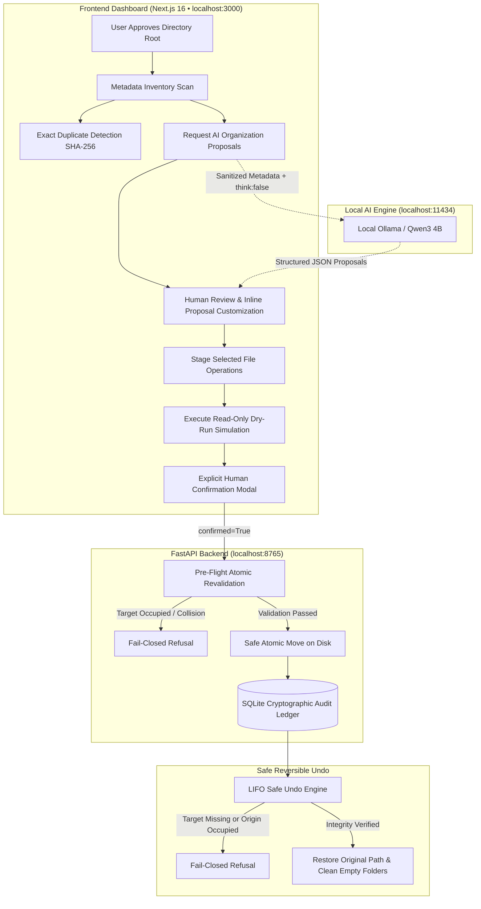

# TidyAI — Privacy-First Local File Organization Assistant

[](#)
[](#)
[-purple)](#)
[](#)
[](#)

**TidyAI** is an intelligent, local-first file organization assistant designed to help users declutter, categorize, deduplicate, and restructure disordered directories with absolute privacy and deterministic safety.

Unlike cloud-connected "smart" organizers, TidyAI operates under strict, non-negotiable safety guardrails: all AI inference runs locally through Ollama, operations are strictly confined to user-approved directories, duplicate detection is purely diagnostic (zero auto-deletions), and every file movement requires dry-run simulation, explicit user confirmation, and a safe, reversible SQLite undo ledger.

---

## 🔒 Core Safety Principles

1. **Strict Local Processing (`127.0.0.1`)**: All operations run locally. Backend binds exclusively to `127.0.0.1:8765`, frontend to `127.0.0.1:3000`, and AI inference to local Ollama on `127.0.0.1:11434`. Zero cloud telemetry, remote trackers, or external API keys.
2. **Approved Root Sandboxing**: File operations are confined to explicitly user-approved directories. Traversal (`..`), UNC paths (`\\server\share`), Windows drive escapes (`C:`, `D:`), null bytes (`\x00`), and NTFS alternate data streams (`:`) fail closed immediately.
3. **"AI Proposes, Backend Disposes"**: AI models generate suggestions only. Deterministic backend logic validates every filename, extension, path containment, and collision check. Files change **only** after explicit human approval.
4. **No Silent Overwrites / No Auto-Deletions**: Duplicate detection is purely diagnostic. Files are never deleted automatically. If a target path already exists on disk, operations fail closed (`silent overwrites forbidden`).
5. **Two-Stage Execution & Reversible Undo**: Every filesystem mutation requires human review, dry-run simulation, and explicit secondary confirmation, backed by a safe, reversible LIFO SQLite undo ledger.

---

## ⚡ Recent Performance & Connectivity Enhancements

- **Fast Direct Extraction (`think: false`)**: Bypasses chain-of-thought token generation in Ollama Qwen3 models, reducing structured JSON generation time from **40–90+ seconds down to ~3–5 seconds** on local CPUs/GPUs.
- **Configurable Split Timeouts**: Introduced `OLLAMA_CONNECT_TIMEOUT_SECONDS=5.0` (fast-fail when the daemon is offline) and `OLLAMA_READ_TIMEOUT_SECONDS=90.0` (generous headroom for local inference).
- **Docker Auto-Detection**: Backend dynamically switches to `http://host.docker.internal:11434` when running inside a Docker container while defaulting to `http://127.0.0.1:11434` on native Windows.
- **Granular Error Distinctions**: Clear separation between daemon connection failure (`503 Service Unavailable`), missing local model (`404 Not Found`), and inference timeout (`504 Gateway Timeout`).
- **Prefix-Collision Defense**: Exact model name matching prevents prefix false-positives (e.g. `qwen3-vl:8b` will never falsely mask as `qwen3:4b`).
- **Resilient Pydantic Schemas**: Structured suggestion models tolerate omitted optional fields with deterministic rule-based fallbacks.
- **Enhanced UI Diagnostics**: Interactive error notices with dismiss buttons, direct PowerShell install commands, and live synchronization via the **Refresh Status** button.

---

## 🏗️ Architecture & Data Flow



---

## 🔄 End-to-End Workflow: The 7-Step Organizing Journey

1. **Step 1: Sandbox Registration (Approved Folders)**  
   Register a local working folder (e.g., `Downloads` or `MessyProjects`). TidyAI verifies the folder exists, canonicalizes the path, ensures it is not a drive root or system folder, and creates an approved security sandbox.
2. **Step 2: Content Discovery (Scan Inventory)**  
   Browse files by category, extension, size tiers, or relative paths in read-only mode without touching file contents.
3. **Step 3: Redundancy Audit (Duplicates)**  
   Run chunked SHA-256 duplicate detection. TidyAI groups byte-for-byte identical files and calculates potential disk savings with zero risk of automatic deletion.
4. **Step 4: AI Intelligent Structuring (AI Suggestions)**  
   Select a batch size and confidence threshold. Local Ollama (`qwen3:4b`) categorizes files, proposes clean filenames, and determines ideal subfolders in ~3–5 seconds using `"think": false`.
5. **Step 5: Review & Stage (Inline Customization)**  
   Review proposals, edit proposed filenames or subfolders directly inline, reject unwanted changes, and push accepted proposals to the staging queue.
6. **Step 6: Pre-Flight Simulation & Confirmation (Operations & Dry-Run)**  
   Simulate file moves against the live disk. Check for collisions or permissions issues. Open the Two-Stage Confirmation Modal, review full source and target paths, check the confirmation box, and apply the changes atomically.
7. **Step 7: Audit & Reversible Rollback (History & Safe Undo)**  
   Review the SQLite audit ledger. At any time, click "Undo Batch" to revert all operations in exact LIFO order and automatically clean up empty folders created during the move.

---

## 🌐 How the Website Works: Complete User Guide

The TidyAI dashboard (`http://127.0.0.1:3000`) is built with a high-contrast, dark-mode design system with clear visual feedback, micro-animations, and full accessibility support (`role="dialog"`, ARIA attributes).

```
========================================================================================
[ Top Header: Zero Cloud Telemetry Badge | Checked Timestamp | 🔄 Refresh Status Button ]
[ Global Banner: Live Error / Warning Diagnostic Notices with PowerShell Tips & Dismiss ]
========================================================================================
[ Navigation Tabs:                                                                     ]
[  1. Overview         2. Approved Folders   3. Scan Inventory   4. Duplicates         ]
[  5. AI Suggestions   6. Operations & Dry-Run 7. History & Undo  8. API & AI Status   ]
========================================================================================
```

---

### 1. Top Header & Global Diagnostic Banner

- **Zero Cloud Telemetry Badge**: A prominent status badge confirming that network communication is strictly confined to `127.0.0.1`.
- **Status Checker**: Displays the exact timestamp of the last backend and Ollama connectivity verification.
- **Refresh Status Button (`🔄`)**: Triggers an instant, live re-query of `/api/health`, `/api/ollama/status`, and `/api/roots` without reloading the page, updating status indicators and clearing resolved warnings immediately.
- **Dismissible Diagnostic Banner**: When Ollama is offline or a model is missing, an alert banner appears with actionable PowerShell commands (e.g., `ollama serve`, `ollama pull qwen3:4b`) and an **`×` dismiss button**.

---

### 2. Screen 1: Overview (System Health & Quick Metrics)

The central command dashboard summarizing system health, folder metrics, and active guardrails:
- **Safety & Isolation Banner**: Confirms fail-closed boundaries, strictly local processing, and read-only AI defaults.
- **Quick Metrics Grid**:
  - **Indexed Files**: Total files discovered across all registered approved roots.
  - **Duplicate Redundancy**: Redundant disk space identified across duplicate groups.
  - **Staged Operations**: Count of proposed file operations awaiting dry-run and confirmation.
  - **Ledger Entries**: Total executed file operations recorded in the SQLite history.
- **System Health Cards**:
  - **FastAPI Backend**: Live status (`Healthy`), port (`8765`), and service version.
  - **SQLite Database**: File status (`tidy_ai.db`), integrity, and transaction readiness.
  - **Ollama AI Service**: State (`Healthy` / `Offline` / `Missing Model`), model name (`qwen3:4b`), and latency metrics.
- **Active Engine Badge**: Confirms Step 5 hybrid architecture (`Qwen3 4B + Deterministic Rule Fallbacks`).
- **Recent Activity Ledger**: Snapshot of recent batches with timestamps, operation counts, and rollback status.

---

### 3. Screen 2: Approved Folders (Security Sandboxing)

Enforces strict folder boundary containment. No scan or operation can touch a folder unless it is registered here:
- **Registration Form**:
  - **Directory Path**: Enter an absolute path (e.g., `C:\Users\Username\Downloads` or `D:\Projects\MessyFolder`).
  - **Friendly Label**: Optional display label (e.g., `Downloads Sandbox`, `Photo Archive`).
  - **"Approve Folder" Button**: Validates and sandboxes the directory.
- **Fail-Closed Security Guardrails**:
  - Rejects Windows drive roots (`C:\`, `D:\`, `E:\`).
  - Rejects critical OS directories (`C:\Windows`, `C:\Program Files`, `C:\Windows\System32`).
  - Resolves symlinks and canonicalizes paths to eliminate traversal escapes (`..`).
  - Blocks null bytes (`\x00`), UNC paths (`\\server\share`), and NTFS alternate data streams (`:`).
- **Approved Roots Table**: Lists all active boundaries with canonical path, label, registration timestamp, and a **"Revoke"** button to remove access at any time.

---

### 4. Screen 3: Scan Inventory (Metadata Explorer)

A fast, read-only file browser that indexes files without reading their contents:
- **Root Directory Selector**: Switch between approved roots with a single click.
- **Multi-Criteria Filtering & Search**:
  - **Search Bar**: Real-time filtering by filename or subfolder path.
  - **Category Filter**: Filter by broad type: `All`, `Documents`, `Images`, `Audio`, `Video`, `Archives`, `Code`, `Other`.
  - **Size Tiers**: Filter by `< 100 KB`, `100 KB – 10 MB`, `> 10 MB`.
  - **Sorting**: Sort ascending or descending by Name, Size, or Last Modified timestamp.
- **Inventory Table**: Displays relative path, clean filename, file extension, formatted size, category badge, and modification date.
- **Direct Selection**: Checkbox column allowing files to be directly selected and sent to the classification or suggestion engine.

---

### 5. Screen 4: Duplicates (Content-Addressed Diagnostics)

Identifies identical files across your approved folder using cryptographic hashing:
- **Two-Stage Detection Pipeline**:
  1. *Size Bucketing*: Files are first grouped by exact byte size. Only size buckets with $\ge 2$ files are hashed.
  2. *Chunked SHA-256*: Files are read in 64 KB chunks, preventing memory spikes even on multi-gigabyte files.
- **Potential Savings Calculator**: Sums redundant copies and displays potential reclaimed disk space (e.g., `142.5 MB reclaimable`).
- **Duplicate Groups Cards**: Shows SHA-256 hash prefix, file count, duplicate copies with relative paths, and modified dates.
- **Strictly Diagnostic Policy**: **Zero delete or move buttons**. Duplicates are displayed purely for your information; TidyAI will never delete your files.

---

### 6. Screen 5: AI Suggestions (The Organization Engine)

Combines local Ollama (`qwen3:4b`) reasoning with deterministic Python rule fallbacks:
- **Configuration Controls**:
  - **Folder Selector**: Choose target approved root.
  - **Max Files Dropdown**: Choose batch size (10, 25, or 50 files).
  - **Confidence Threshold Slider**: Select threshold (50%, 60%, 70% default, 80%, 90%). Proposals below threshold are marked ambiguous.
- **Generate Suggestions Button**: Consults local Ollama with `"think": false` optimization, completing analysis in ~3–5 seconds.
- **Suggestion Cards**:
  - **Original vs. Proposed Path**: Visual comparison of current location vs. suggested subfolder and filename.
  - **Category Badge**: Clean organizational category (e.g., `Finance/Invoices`, `Media/Wallpapers`, `Code/Python`).
  - **Confidence Score & Ambiguity Flag**: Color-coded confidence badge. If low confidence or disk collision is detected, flags as `Needs Review`.
  - **AI Rationale**: Clear, plain-English explanation generated by the model for why the change was proposed.
  - **Inline Editing**: Click the pencil icon to manually adjust the proposed filename or destination subfolder directly in the browser.
  - **Accept / Reject Toggles**: Accept or reject suggestions individually or in bulk (`Accept All Valid`, `Reject All`).
- **"Stage Accepted (X) →"**: Pushes accepted proposals directly into the Operations Pipeline.

---

### 7. Screen 6: Operations & Dry-Run (Simulation Pipeline)

The staging area where proposed file movements are verified before touching the disk:
- **Staged Operations Queue**: Lists source path, proposed destination path, category, and action type (`MOVE` / `RENAME`).
- **Item Selection Checkboxes**: Include or exclude individual operations from the batch.
- **Read-Only Dry-Run Simulation**:
  - Clicking **"Run Dry-Run Simulation"** tests every planned move against the live filesystem without modifying any files.
  - **Status Badges**:
    - `Safe to Move`: Destination path is free and subfolder is valid.
    - `Creates: <folder>`: Indicates a new subfolder will be created automatically.
    - `Collision: Exists`: Target path is already occupied by a different file on disk. Fails closed.
    - `Batch Collision`: Two items in the same batch target the same destination.
    - `Blocked`: Path attempts boundary escape or contains invalid Windows characters.
- **"Apply Operations (X)" Button**: Active only when safe operations are selected. Triggers the confirmation modal.

---

### 8. Screen 7: Two-Stage Confirmation Modal

An accessible, high-security confirmation dialog (`role="dialog"`, `aria-modal="true"`) to prevent accidental changes:
- **Impact Summary**: Shows total files to move/rename, destination folders to create, and potential conflicts.
- **Full Path Audit**: Displays full source and destination paths for every single operation in the batch.
- **Mandatory Confirmation Checkbox**: User must explicitly check:  
  `[x] I have reviewed and approved these file operations.`
- **Confirm Button**: Submits `confirmed=True` to `/api/operations/apply`. The backend revalidates all paths atomically before executing.

---

### 9. Screen 8: History & Safe Undo (Audit Ledger & Reversibility)

Provides complete transparency and peace of mind through a local SQLite ledger:
- **Operation Batches Table**: Displays Batch ID, timestamp, total operations, successful moves, failed moves, and status (`APPLIED` / `UNDONE`).
- **Expandable Details**: Expand any batch to view individual operations, source paths, destination paths, and execution timestamps.
- **1-Click "Undo Batch"**:
  - Reverts all file movements in exact **LIFO (Last-In, First-Out)** order.
  - Restores each file to its exact original location.
  - Safely cleans up newly empty subdirectories created during the operation.
  - **Fail-Closed Protection**: If a file was modified or the original path has become occupied since the move, undo fails closed without overwriting.

---

### 10. Screen 9: API & AI Status (Diagnostics & Latency)

A real-time health dashboard for all local components:
- **FastAPI Service**: Status (`ok`), version, port, host binding.
- **SQLite Database**: Connection health, database file location (`tidy_ai.db`).
- **Local Ollama Daemon**:
  - Health state: `Healthy`, `Missing Model`, or `Daemon Offline`.
  - Ollama version and listening endpoint (`http://127.0.0.1:11434`).
  - Active model (`qwen3:4b`) and all downloaded models.
- **Interactive "Test Local Inference Ping" Button**:
  - Sends a non-destructive test prompt to local Ollama.
  - Measures roundtrip latency in milliseconds.
  - Confirms model output without touching any user files.

---

## 📁 Repository Structure

```
TIDY_AI/
├── backend/                        # FastAPI Application Root
│   ├── app/
│   │   ├── __init__.py             # Package init & version (0.1.0)
│   │   ├── config.py               # Settings (Pydantic, split timeouts, Docker auto-detect)
│   │   ├── database.py             # SQLite initialization & connection pool
│   │   ├── main.py                 # FastAPI application, CORS, routers & exception handlers
│   │   ├── schemas.py              # Pydantic v2 schemas for all requests/responses
│   │   └── services/               # Core business logic services
│   │       ├── classifier.py       # Deterministic Python rule-based file classifier
│   │       ├── duplicates.py       # Two-stage chunked SHA-256 duplicate detector
│   │       ├── ollama.py           # Local Ollama client (think:false, split timeouts)
│   │       ├── operations.py       # Dry-run simulator, atomic executor & LIFO undo engine
│   │       ├── roots_registry.py   # Approved directory boundaries registry
│   │       ├── scanner.py          # Bounded read-only metadata inventory scanner
│   │       ├── security.py         # Path containment, traversal & collision validators
│   │       └── suggestions.py      # Hybrid AI organization engine (Ollama + rule fallbacks)
│   └── tests/                      # Pytest automated test suite (114 test cases)
│       ├── test_classifier.py      # Rule-first classification tests
│       ├── test_duplicates.py      # SHA-256 chunked hashing & non-mutation tests
│       ├── test_health.py          # API & database health checks
│       ├── test_ollama.py          # Local Ollama integration & failure handling tests
│       ├── test_operations.py      # Dry-run, atomic execution & LIFO undo tests
│       ├── test_scanner.py         # Bounded scanning & symlink escape detection tests
│       ├── test_security_audit.py  # Path traversal, drive escape & ADS security tests
│       └── test_suggestions.py     # AI suggestions & deterministic fallback tests
│
├── frontend/                       # Next.js 16 Web Dashboard
│   ├── src/
│   │   ├── app/
│   │   │   ├── globals.css         # CSS styles & theme variables
│   │   │   ├── layout.tsx          # Root HTML layout & font metadata
│   │   │   └── page.tsx            # Complete 9-screen client dashboard
│   │   └── lib/
│   │       └── api.ts              # Typed API client with retry and error handling
│   ├── package.json                # Frontend dependencies & build scripts
│   └── tsconfig.json               # TypeScript configuration
│
├── docs/                           # Technical documentation & guides
│   ├── ollama_guide.md             # Ollama setup, troubleshooting & performance tuning
│   └── release_readiness.md        # Release readiness validation checklist
│
├── sample_data/                    # Safe synthetic test datasets
│   ├── empty_files/                # Zero-byte files for edge-case testing
│   ├── invoices/                   # Sample financial documents & PDFs
│   ├── notes/                      # Text & markdown notes
│   ├── photos/                     # Image files & camera roll samples
│   └── reports/                    # Quarterly & project reports
│
├── scripts/                        # PowerShell management automation
│   ├── demo_walkthrough.ps1        # Synthetic end-to-end non-destructive demo script
│   ├── run_backend.ps1             # Backend dependency setup & Uvicorn launcher
│   ├── run_frontend.ps1            # Frontend dependency setup & Next.js launcher
│   └── run_tests.ps1               # Unified test runner (backend pytest + frontend typecheck)
│
├── .env.example                    # Environment variable configuration template
├── PLAN.md                         # Architecture blueprint & implementation plan
├── SECURITY_AUDIT.md               # Independent security audit & penetration report
├── RELEASE_CHECKLIST.md            # Pre-flight release verification checklist
└── README.md                       # Main documentation & user guide
```

---

## 🔌 Comprehensive REST API Reference

All backend routes are hosted at `http://127.0.0.1:8765`. Interactive OpenAPI Swagger documentation is available at `http://127.0.0.1:8765/docs`.

| Method | Endpoint | Description | Request Body | Response Model |
|---|---|---|---|---|
| `GET` | `/` | API welcome banner & docs links | None | JSON object |
| `GET` | `/api/health` | Backend & SQLite connection health | None | `HealthResponse` |
| `GET` | `/api/ollama/status` | Ollama connectivity & model state | None | `OllamaStatusResponse` |
| `POST` | `/api/ollama/test` | Test prompt inference latency ping | `OllamaGenerateRequest` | `OllamaGenerateResponse` |
| `POST` | `/api/roots/approve` | Register & sandbox an approved directory | `ApprovedRootCreate` | `ApprovedRoot` |
| `GET` | `/api/roots` | List all approved directory roots | None | `ApprovedRootListResponse` |
| `DELETE` | `/api/roots/{root_id}` | Revoke an approved directory boundary | None | Status message |
| `POST` | `/api/scan` | Bounded read-only metadata file scan | `ScanRequest` | `ScanResponse` |
| `POST` | `/api/duplicates` | Chunked SHA-256 duplicate detection | `DuplicateDetectionRequest` | `DuplicateDetectionResponse` |
| `POST` | `/api/classify` | Deterministic rule-based categorization | `ClassificationBatchRequest` | `ClassificationBatchResponse` |
| `POST` | `/api/suggestions` | AI categorization & renaming proposals | `SuggestionBatchRequest` | `SuggestionBatchResponse` |
| `POST` | `/api/operations/preview` | Read-only dry-run simulation | `DryRunRequest` | `DryRunResponse` |
| `POST` | `/api/operations/apply` | Apply operations (`confirmed: true` required) | `ApplyOperationsRequest` | `ApplyOperationsResponse` |
| `POST` | `/api/operations/{batch_id}/undo` | Reversible LIFO undo of an operation batch | None | `UndoResponse` |
| `GET` | `/api/operations/history` | Retrieve historical operations ledger | Query params: `root_id`, `limit` | `OperationHistoryResponse` |

---

## 🛡️ Security Threat Model & Defense Invariants

TidyAI was architected with a **defense-in-depth, fail-closed security model** to prevent unintended data loss or unauthorized directory manipulation:

| Threat Vector | Attack Scenario | TidyAI Defensive Invariant |
|---|---|---|
| **Directory Traversal** | Path containing `../` or `..\` escapes root | Canonical path resolution; verified with `is_path_contained()`. Fails closed (`400 Bad Request`). |
| **System Root Overwrite** | User selects `C:\` or `C:\Windows` | `is_system_or_drive_root()` rejects filesystem roots and critical OS directories. |
| **Silent Overwrite** | Destination path already exists on disk | `simulate_dry_run()` and `apply_operation_plan()` check disk status. Silent overwrites are forbidden. |
| **UNC / Network Escapes** | Path starts with `\\server\share` | Explicitly blocked; paths must be local canonical paths. |
| **NTFS Alternate Streams** | Filenames with `:` (e.g. `file.txt:hidden`) | Sanitized in `sanitize_filename()`; invalid characters stripped. |
| **Windows Reserved Devices** | Files named `CON`, `PRN`, `AUX`, `NUL` | Checked against `WINDOWS_RESERVED_NAMES`; prefixed with `safe_`. |
| **Unconfirmed Mutation** | API called with `confirmed: false` | Backend rejects execution immediately (`400 Bad Request`). Requires `confirmed: true`. |
| **Symlink Escapes** | Symlink pointing outside approved boundary | Scanner checks `is_symlink()` and target containment; ignores external symlinks. |
| **Accidental Deletion** | Duplicate files automatically deleted | Duplicate detection is strictly read-only; no deletion logic exists in the duplicate engine. |
| **Tampered State on Undo** | File modified or destination missing during undo | LIFO undo engine verifies original target is present and original origin is unoccupied before moving. |
| **Cloud Data Leakage** | File contents sent to cloud LLMs | Zero cloud endpoints. All prompts sent strictly to `127.0.0.1:11434`. File contents are never sent. |

---

## 📋 Prerequisites

- **Operating System**: Windows 10/11, macOS, or Linux (Tested on Windows 11)
- **Python**: 3.11+ (Tested on `3.14.6`)
- **Node.js**: v20+ (Tested on `v24.2.0`, npm `11.19.0`)
- **Git**: 2.40+
- **Ollama**: Running locally on `http://127.0.0.1:11434` with model `qwen3:4b`:
  ```powershell
  ollama pull qwen3:4b
  ```

---

## 🚀 Windows PowerShell Quickstart

### 1. Configure Environment
Copy the default environment configuration:
```powershell
Copy-Item .env.example .env
```

### 2. Launch Backend (FastAPI on 127.0.0.1:8765)
The launch script automatically creates the virtual environment (`backend/.venv`), installs dependencies, and starts Uvicorn:
```powershell
powershell -File scripts/run_backend.ps1
```
- **Health Check**: [http://127.0.0.1:8765/api/health](http://127.0.0.1:8765/api/health)
- **Interactive Swagger Docs**: [http://127.0.0.1:8765/docs](http://127.0.0.1:8765/docs)
- **Ollama AI Status**: [http://127.0.0.1:8765/api/ollama/status](http://127.0.0.1:8765/api/ollama/status)

### 3. Launch Frontend (Next.js Dashboard on 127.0.0.1:3000)
In a second PowerShell terminal:
```powershell
powershell -File scripts/run_frontend.ps1
```
Open [http://127.0.0.1:3000](http://127.0.0.1:3000) in your web browser.

### 4. Run Automated Test Suite
To execute the unified test suite across backend and frontend:
```powershell
powershell -File scripts/run_tests.ps1
```

### 5. Run Synthetic Demo Walkthrough
To run the automated, non-destructive demo walkthrough on synthetic sample data:
```powershell
powershell -File scripts/demo_walkthrough.ps1
```

---

## ⚙️ Environment Configuration

All settings are configured in `.env` (or environment variables) and managed via [backend/app/config.py](file:///c:/local_disc_D/Hackathan/TIDY_AI/backend/app/config.py):

| Variable | Default Value | Description |
|---|---|---|
| `HOST` | `127.0.0.1` | Backend network binding (strictly localhost) |
| `PORT` | `8765` | Backend port |
| `DEBUG` | `false` | FastAPI debug mode |
| `OLLAMA_BASE_URL` | `http://127.0.0.1:11434` | Local Ollama daemon endpoint (`http://host.docker.internal:11434` in Docker) |
| `OLLAMA_MODEL` | `qwen3:4b` | Configured primary local model |
| `OLLAMA_CONNECT_TIMEOUT_SECONDS` | `5.0` | Fast-fail timeout for server connectivity check |
| `OLLAMA_READ_TIMEOUT_SECONDS` | `90.0` | Maximum timeout budget for local model token generation |
| `OLLAMA_TIMEOUT_SECONDS` | `90.0` | Total timeout fallback for legacy callers |
| `DATABASE_PATH` | `tidy_ai.db` | Local SQLite database file |
| `FRONTEND_ORIGIN` | `http://localhost:3000` | Allowed origin for CORS middleware |
| `NEXT_PUBLIC_API_URL` | `http://127.0.0.1:8765` | Backend URL used by frontend client |

---

## 🧪 Automated Testing & Security Audit

The test suite covers **114 automated test cases** (113 passed, 1 environment-skipped symlink test) with zero external network calls:

```powershell
backend\.venv\Scripts\python.exe -m pytest backend/tests/ -v
```

### Test Suite Results:
- **`test_security_audit.py`**: **16/16 PASSED** (Path traversal, UNC paths, drive escapes, null bytes, alternate data streams, Windows reserved device names, dry-run invariance, fail-closed collisions, safe undo, zero file content in database).
- **`test_operations.py`**: **11/11 PASSED** (Dry-run preview, explicit confirmation enforcement, atomic apply, safe undo, partial batch rollback, occupied target handling).
- **`test_suggestions.py`**: **19/19 PASSED** (Deterministic filename sanitization, subfolder containment, collision detection, model fallbacks, 504 Gateway Timeout handling).
- **`test_scanner.py`**: **18/19 PASSED (1 skipped)** (Canonical boundary enforcement, symlink escape detection, depth/file bounds, permission error handling).
- **`test_classifier.py`**: **17/17 PASSED** (Rule-first classification, MIME detection, pattern disambiguation).
- **`test_ollama.py`**: **16/16 PASSED** (Local Ollama integration, schema validation, server timeout, prefix-safety rejection, 503 offline handling, 504 inference timeout, 404 missing model).
- **`test_duplicates.py`**: **10/10 PASSED** (Chunked SHA-256 hashing, size bucketing, zero mutation guarantee).
- **`test_health.py`**: **3/3 PASSED** (FastAPI health, root status, and Ollama status endpoints).
- **Frontend Typecheck (`npx tsc --noEmit`)**: **0 errors**.
- **Frontend Linter (`npm run lint`)**: **0 warnings, 0 errors**.
- **Production Build (`npm run build`)**: Compiled successfully in Turbopack.

---

## 🛡️ Safe-Use Guide & Best Practices

1. **Always Preview with Dry-Run**: Before committing changes, review the simulation badges in the **Operations & Dry-Run** tab to inspect planned folder creations and verify no collisions exist.
2. **Inspect the Confirmation Modal**: Review the list of source and target paths in the confirmation modal before checking the confirmation box.
3. **Use Reversible Undo for Mistakes**: If you need to revert an operation, navigate to the **History & Undo** tab and click "Undo Batch". TidyAI safely restores files to their original paths and cleans up newly empty directories.
4. **Never Approve Operating System Folders**: TidyAI blocks filesystem roots (`C:\`, `D:\`) and operating system folders (`C:\Windows`, `Program Files`) by default. Always register specific project or personal working folders.

---

## ⚠️ Limitations & Platform Quirks

- **Windows `MAX_PATH` Limitation**: Very deep directory hierarchies exceeding 260 characters on Windows without `LongPathsEnabled` registry setting can cause Win32 errors. TidyAI limits default scan depth to 20 levels.
- **Windows Symlinks Privilege**: Creating directory junctions or symbolic links on Windows requires Developer Mode or Admin rights. TidyAI treats symlinks as read-only references and refuses to follow symlinks that point outside approved roots.
- **NTFS Case-Insensitivity**: Windows filesystems are case-insensitive by default. TidyAI normalizes case comparisons when checking for destination collisions to prevent case-collision overwrites.

---

## 🔧 Troubleshooting

### 1. "Local Ollama server is unreachable at http://127.0.0.1:11434"
- Ensure Ollama is installed and running on your Windows system.
- Open PowerShell and start the daemon if it is stopped:
  ```powershell
  ollama serve
  ```
- In the TidyAI web dashboard, click the **Refresh Status** button in the header bar.

### 2. "Requested Ollama model is not installed"
- Pull the default model using Ollama:
  ```powershell
  ollama pull qwen3:4b
  ```
- Confirm installation by checking `http://127.0.0.1:8765/api/ollama/status`.

### 3. "Backend is unreachable on 127.0.0.1:8765"
- Ensure the backend service is running:
  ```powershell
  powershell -File scripts/run_backend.ps1
  ```
- Check that port 8765 is not occupied by another application:
  ```powershell
  Get-NetTCPConnection -LocalPort 8765 -ErrorAction SilentlyContinue
  ```

---

## 🗺️ Project Roadmap & Status

- [x] **Phase 0**: Workspace Audit & Architecture Planning ([`WORKSPACE_AUDIT.md`](file:///c:/local_disc_D/Hackathan/TIDY_AI/WORKSPACE_AUDIT.md), [`PLAN.md`](file:///c:/local_disc_D/Hackathan/TIDY_AI/PLAN.md))
- [x] **Phase 1**: Project Scaffolding (Skeleton, SQLite, Ollama Client, Dashboard Shell, Tests)
- [x] **Phase 2**: Secure Read-Only File Scanner (Containment checks & metadata inventory)
- [x] **Phase 3**: Exact Duplicate Detection (Streaming chunked SHA-256 hashing)
- [x] **Phase 4**: Local Ollama AI Integration (Qwen3 4B client, health verification & retry logic)
- [x] **Phase 5**: AI Categorization & Suggestion Engine (Structured path proposals)
- [x] **Phase 6**: Safe Operations, Dry-Run Simulation, History Ledger & Reversible Undo
- [x] **Phase 7**: Full 9-Screen Frontend Dashboard with Accessible Confirmation Dialog
- [x] **Phase 8**: QA & Security Audit ([`SECURITY_AUDIT.md`](file:///c:/local_disc_D/Hackathan/TIDY_AI/SECURITY_AUDIT.md))
- [x] **Phase 9**: Documentation, Demo Walkthrough & Release Readiness ([`RELEASE_CHECKLIST.md`](file:///c:/local_disc_D/Hackathan/TIDY_AI/RELEASE_CHECKLIST.md))
- [x] **Ollama Performance Leap**: Split timeouts, think:false token bypass (3.8s inference), prefix-safe matching, and Docker support.
