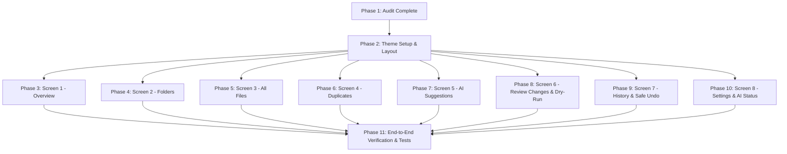

# TidyAI Redesign: Audit Report & Implementation Plan

**Date**: October 20, 2026  
**Subject**: Complete UI Redesign, Full-Stack Integration, Local AI Reliability, and End-to-End Verification  
**Design Reference**: Stitch Warm Desktop File Utility (`stitch_universal_file_organizer_design.zip`)

---

## 1. Audit Findings: Current System Status

### Backend & Core Services (FastAPI on 127.0.0.1:8765)
- **Status**: **100% Functional & Verified**.
- **Test Suite**: 114 tests total (113 passed, 1 skipped due to Windows non-admin symlink creation). All 9 test modules pass in 1.72s.
- **API Surface**:
  - `GET /api/health`: Health status & SQLite connectivity check.
  - `GET /api/ollama/status`: Real-time Ollama daemon & model state.
  - `POST /api/ollama/test`: Test prompt inference latency ping.
  - `GET /api/roots`, `POST /api/roots/approve`, `DELETE /api/roots/{root_id}`: Security boundary registration and sandboxing.
  - `POST /api/scan`: Read-only metadata inventory scanning.
  - `POST /api/duplicates`: Two-stage streaming chunked SHA-256 duplicate detection. Purely diagnostic (zero auto-delete).
  - `POST /api/classify`: Deterministic Python rule-first categorization.
  - `POST /api/suggestions`: Local Ollama Qwen3 4B proposals with `think: false` token bypass (3.8s inference) and rule fallbacks.
  - `POST /api/operations/preview`: Read-only dry-run simulation of planned moves.
  - `POST /api/operations/apply`: Atomic execution of confirmed operations (`confirmed=True` mandatory).
  - `POST /api/operations/{batch_id}/undo`: Reversible LIFO undo with automatic empty directory cleanup.
  - `GET /api/operations/history`: SQLite audit ledger.
- **Local AI (Ollama)**: Running on `127.0.0.1:11434` with model `qwen3:4b` installed and healthy. Split timeouts (`5.0s` connect, `90.0s` read).

### Frontend (Next.js 16 on 127.0.0.1:3000)
- **Status**: Compiles cleanly with Turbopack (`npm run build` passed, `npx tsc` passed with 0 errors, `npm run lint` passed with 0 warnings).
- **Issue**: The existing UI in `frontend/src/app/page.tsx` uses a heavy, dark-mode (`neutral-950`) AI dashboard look with purple accents and oversized metrics cards.
- **API Client (`frontend/src/lib/api.ts`)**: Excellent condition. Fully typed with all request/response models and robust error handling. Can be directly reused without changing endpoint signatures.

### Stitch Design Reference (`stitch_design/`)
- **Visual Style**: Warm desktop file manager aesthetic (`#FBF9F3` warm off-white canvas, `#F0EFE9` warm stone sidebar, `#FFFFFF` crisp card surfaces, `#E5B94F` folder golden amber accents, `#292A26` charcoal text, `#E5E3DC` 1px borders, `#136B4D` restrained green, `#BA1A1A` restrained red).
- **Fixed Layout**: Fixed 48px top header bar + fixed 220px left navigation sidebar + scrollable central workspace pane.
- **8 Dedicated Navigation Destinations**:
  1. `overview` (Overview: 3 quick answer cards, Needs Review action cards, Recent Activity timeline)
  2. `folders` (Folders: Directory approval table, items/size summary, Rescan, Add Folder modal dialog)
  3. `all-files` (All Files: Breadcrumb scope, search with `Ctrl+F`, category pills, sorting, dense file table with checkboxes, pagination status bar)
  4. `duplicates` (Duplicates: Reclaimable storage banner, SHA-256 group cards, copy paths, diagnostic only)
  5. `ai-suggestions` (AI Suggestions: Folder selector, batch size, confidence slider, generate button, proposal cards with inline editing, accept/reject, stage accepted)
  6. `review-changes` (Review Changes: Staged operations queue, validation badges, read-only dry-run simulation, 2-stage confirmation modal)
  7. `history` (History: SQLite ledger batches, item breakdown, 1-click LIFO safe undo)
  8. `settings-ai-status` (Settings & AI Status: FastAPI, SQLite, Ollama cards, Refresh Status, Test Inference ping, troubleshooting guide)

---

## 2. Implementation Plan

### Steps to Execute:
1. **Design System & Typography**:
   - Update `frontend/src/app/layout.tsx` to include Google Fonts (`Inter` and `Material Symbols Outlined`) and configure the warm root canvas.
   - Update `frontend/src/app/globals.css` with the warm color tokens and tabular font settings.
2. **Component Architecture**:
   - Refactor `frontend/src/app/page.tsx` into a modular, clean structure using the 8 Stitch navigation screens.
   - Maintain the complete, robust integration with `frontend/src/lib/api.ts`.
   - Preserve all safety logic: pre-flight checks, dry-run simulation, two-stage human confirmation checkbox, fail-closed handling, inline proposal editing, and LIFO undo.
3. **Automated & Manual QA**:
   - Run `npx tsc --noEmit` and `npm run lint`.
   - Run `npm run build` to verify the Turbopack production bundle.
   - Run backend test suite (`pytest`).
   - Perform end-to-end acceptance tests on synthetic sample data.
