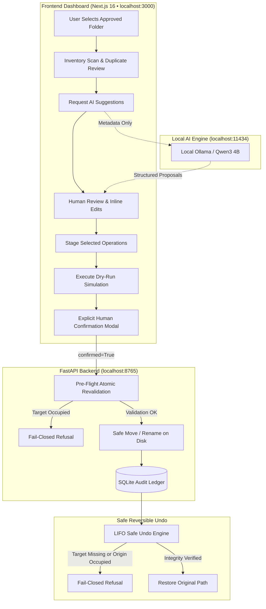

# TidyAI — Architecture & Security Specification

TidyAI is engineered as a **local-first, deterministic, privacy-preserving file organization engine**. It pairs a local AI model (Ollama running `qwen3:4b`) with a rigorous, fail-closed backend validation system to guarantee that no user file is ever lost, silently overwritten, or moved outside approved boundaries.

---

## 1. Architectural Philosophy: "AI Proposes, Backend Disposes"

Large Language Models are probabilistic generators. In TidyAI, the AI model is treated as an **untrusted proposal engine**:
- The model generates proposals (filename, category, relative subfolder, rationale).
- The model is **never** given filesystem write access, execution permissions, or network connectivity.
- All proposals pass through a deterministic pipeline that validates Windows filename legality, boundary containment, extension preservation, and collision prevention.
- File mutations can **only** occur after explicit, human confirmation.

---

## 2. Core System Components

### 1. Secure Read-Only File Scanner (`backend/app/services/scanner.py`)
- Traverses approved root directories using `os.scandir()`.
- Captures minimal metadata: filename, extension, file size, modified time, creation time, and broad file category.
- Enforces depth bounds (`max_depth=20`) and file limits (`max_files=10,000`).
- Automatically ignores system folders (`.git`, `node_modules`, `__pycache__`, `$RECYCLE.BIN`, `.venv`).
- Refuses to follow symlinks escaping the approved root boundary.
- **Strictly read-only**: never reads file contents or modifies timestamps.

### 2. Exact Duplicate Detection (`backend/app/services/duplicates.py`)
- Employs a two-stage streaming pipeline:
  1. **Size Bucketing**: Groups files by exact byte size. Only size buckets with $\ge 2$ files proceed to hashing.
  2. **Chunked Streaming SHA-256**: Streams files in 64 KB chunks to prevent memory exhaustion.
- Re-checks file size and timestamp after read to detect files modified during hashing.
- **Diagnostic Only**: Strictly zero automatic deletion or movement of duplicates.

### 3. Deterministic Classifier (`backend/app/services/classifier.py`)
- Evaluates file extensions, MIME types, and filename patterns first before AI invocation.
- Flags suspicious or ambiguous items (e.g. double extensions like `.pdf.exe`).
- Provides immediate offline categorization when AI is unavailable.

### 4. AI Suggestion Engine (`backend/app/services/suggestions.py`)
- Interacts with local Ollama daemon (`127.0.0.1:11434`) using `qwen3:4b`.
- Sends sanitized metadata only (filename, extension, size, existing relative path). Never sends file contents.
- Deterministically validates all model outputs:
  - Preserves original file extension (fail-closed if altered or dropped).
  - Sanitizes invalid Windows characters (`< > : " / \ | ? *`) and control codes.
  - Rejects Windows reserved device names (`CON`, `PRN`, `AUX`, `NUL`, `COM1-9`, `LPT1-9`).
  - Detects destination collisions on disk and internal collisions within the batch.

### 5. Safe Operations & Undo Engine (`backend/app/services/operations.py`)
- **Dry-Run Simulation**: Invariant preview that checks source existence, destination collisions, and permissions with **zero disk writes**.
- **Confirmed Execution**: Requires `confirmed=True`. Re-validates every item immediately before moving. Fails closed on any collision.
- **Cryptographic Audit Ledger**: Persists batch records and items into SQLite (`tidy_ai.db`).
- **Safe LIFO Undo**: Reverses operations in reverse execution order. Fails closed if the target file has moved or the original path has become occupied.

---

## 3. Network & Privacy Isolation

| Property | Implementation |
|---|---|
| **Backend Host Binding** | Binds exclusively to `127.0.0.1:8765` |
| **Frontend Host Binding** | Binds exclusively to `127.0.0.1:3000` |
| **AI Daemon Binding** | Connects exclusively to `127.0.0.1:11434` |
| **CORS Policy** | Restricted strictly to `http://localhost:3000` and `http://127.0.0.1:3000` |
| **External Telemetry** | 100% disabled; zero cloud API dependencies |
| **Data in Database** | SQLite ledger stores only relative paths and timestamps; zero file content |
